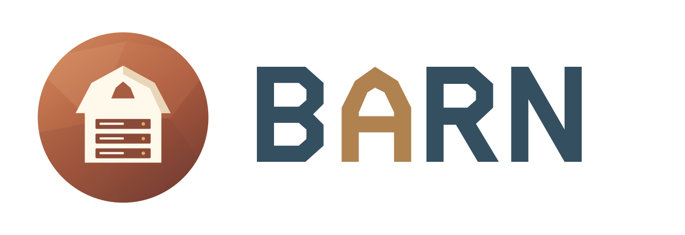

<h1 align="center">
  <a href="https://barn.pgsty.com/">
    <picture>
      <source media="(prefers-color-scheme: dark)" srcset=".github/barn-logo-dark.svg">
      
    </picture>
  </a>
</h1>

<p align="center">
  <strong>Bootstrap And Run Nodes</strong><br>
  Native virtual machines for macOS and Linux.
</p>

<p align="center">
  <a href="https://barn.pgsty.com/">Website</a> ·
  <a href="https://barn.pgsty.com/docs/start/tutorial/">Quick Start</a> ·
  <a href="https://barn.pgsty.com/docs/">Documentation</a> ·
  <a href="https://barn.pgsty.com/blog/">Blog</a> ·
  <a href="CHANGELOG.md">Changelog</a> ·
  <a href="CONTRIBUTING.md">Contributing</a> ·
  <a href="SECURITY.md">Security</a> ·
  <a href="https://barn.pgsty.com/zh/">中文</a>
</p>

<p align="center">
  <a href="https://barn.pgsty.com/"></a>
  <a href="https://github.com/pgsty/barn/actions/workflows/ci.yml"></a>
  <a href="https://github.com/pgsty/barn/releases/tag/v1.2.0"></a>
  <a href="go.mod"></a>
  <a href="LICENSE"></a>
</p>


## What is Barn?

Barn creates local virtual machines for development and testing:

- **Linux labs on macOS and Linux.** Describe nodes in one Ansible-compatible
  YAML inventory. Barn starts QEMU VMs with fixed IPs,
  SSH access, and test data disks. Use the same inventory with
  [Pigsty](https://github.com/pgsty/pigsty) to deploy PostgreSQL and other services.
- **macOS machines on Apple Silicon.** `barn mac` creates named macOS 27 VMs
  with a native desktop, SSH, shared folders, and text clipboard sharing.
  Each machine has its own disk, credentials, and private subnet.

Linux uses QEMU with HVF on macOS or KVM on Linux for native guests, and TCG
software emulation for a different guest architecture. Mac guests use Apple's
Virtualization framework. Barn runs on your hardware and works independently
of Pigsty.

Barn **1.2.0**, released on 2026-11-12, adds resource overrides,
recoverable root-disk growth, configurable lifecycle concurrency, and
inventory-based host names. Source builds use Go 1.27.4.
It embeds signed image catalog revision **2026110502**.
See the [release notes](.github/releases/1.2.0.md).

## Install

[1.2.0](https://github.com/pgsty/barn/releases/tag/v1.2.0) is published on
GitHub's regular release channel. `releases/latest` and the download installer
select it by default.

**macOS — Homebrew**

```bash
brew install pgsty/infra/barn
barn version
```

**Linux — download installer**

The installer selects the native arm64 or amd64 archive, verifies it, and
installs into `~/.local/bin` without sudo:

```bash
curl -fLO https://github.com/pgsty/barn/releases/latest/download/install.sh
bash install.sh
export PATH="$HOME/.local/bin:$PATH"
barn version
```

Add the PATH line to your shell configuration when using the download installer.
Set `BARN_VERSION=1.2.0` to pin a version.
DEB/RPM packages and manual archives are also available; see
[installation](https://barn.pgsty.com/docs/start/installation/) for requirements
and upgrades.

## Start a Linux lab

```bash
barn up
barn ssh
```

On a first interactive run, with no inventory or existing deployment, `up`
creates a one-node `barn.yml`, prepares host dependencies and networking,
downloads the verified Ubuntu 24.04 image, and waits for SSH. It shows the
host changes and asks once before applying them; sudo may still ask for your
password. Without a terminal, run `barn setup --yes` first. Run `exit` to return
from the guest to your host.

The default VM has 1 vCPU and 2 GiB of memory, a 64 GiB root disk, and a
128 GiB test disk at `/data`. Disk files grow as data is written. When upgrading
from 1.1.0, set `vm_cpu: 2` and `vm_mem: 4GiB` explicitly in the inventory to
retain its earlier defaults, and inspect `barn plan` before changing resources.

To choose the configuration before booting, use `barn init` and edit the file.
`barn init full` generates four nodes. Use `--image` to write one image
reference into `all.vars` for every generated node; aliases, channels, and
version selectors are accepted, and the image is downloaded later by the
normal catalog-backed lifecycle flow:

```bash
barn init full --image el9 -o lab.yml
```

`--image` also has the short form `-I`. To override an existing inventory for
one invocation, use `barn up -I u24`. The override replaces `vm_image` and
`vm_version` for the selected nodes. The inventory is not rewritten; set
`vm_image` there and remove any superseded `vm_version` to keep the choice.

Use `--arch/-A` to override the deployment's `vm_arch`. Accepted values are
`amd64` (`x86_64`, `x64`), `arm64` (`aarch64`, `a64`), and `native`.
For example, Apple Silicon can run an amd64 Linux guest through QEMU TCG:

```bash
barn plan -I u24 -A amd64
barn up -I u24 -A amd64
```

Cross-architecture guests are slower than native guests; use them for
compatibility testing, not performance measurements. All nodes in one
deployment share the guest architecture. To keep it, set `vm_arch` in
`all.vars`. `plan`, `reload`, `recreate`, and `resize` accept the same overrides.
Changing an existing VM's image or architecture still requires `recreate`;
`up` reports the change without replacing its disks.

These flags also work throughout configuration and image preparation:

| Command | Image | Architecture | Effect |
| --- | --- | --- | --- |
| `init`, `setup <template>` | `-I` | `-A` | Write `vm_image`/`vm_arch` into a generated inventory |
| `validate` | `-I` | `-A` | Validate the inventory with temporary overrides |
| `image info`, `image pull` | Positional image reference | `-A` | Select the target artifact; legacy `-a` still works |
| `image import --name local-…` | Positional file path | `-A` | Record the imported image's guest architecture |

For example, `barn init full -I el9 -A amd64` saves both choices, while
`barn validate -f pigsty.yml -I u24 -A arm64` only checks them. Setup's template
flags do not modify existing inventories. On Linux, setup currently installs
native host dependencies; a cross-architecture guest also needs its target
QEMU system emulator and firmware installed. Named image imports default to
the host architecture; pass `-A` for a foreign image, since qcow2 metadata does
not identify the guest CPU.

An existing Pigsty inventory works too:

```bash
barn plan -f pigsty.yml
barn up -f pigsty.yml
```

To change a running VM, edit its `vm_cpu` or `vm_mem` in the inventory and
apply the change with `barn resize`. QEMU hot-plugs an increase when the
backend supports it; otherwise Barn briefly stops and starts the same VM.
The VM UUID, disks, and SSH keys are preserved, and the inventory remains
under your control. The launch-time CPU and memory capacity is a virtual QEMU
limit; it does not pre-allocate the reserved host CPU or RAM:

```bash
vi barn.yml
barn resize meta
```

Barn prepares the machines; installing Pigsty services is a separate step.
Follow the [Linux quick start](https://barn.pgsty.com/docs/start/tutorial/).

## Run a macOS VM

macOS guests require Apple Silicon, macOS 27 or later, and `Barn.app`.
The Apple Silicon archive includes the signed, notarized CLI, hosts
helper, and `Barn.app`. Homebrew installs all three and QEMU; `barn mac`
finds its matching native component automatically. No source build or Xcode
installation is needed to run the packaged app:

```bash
barn mac doctor
barn mac up
barn mac open
barn mac ssh
```

The first `up` asks before downloading Apple's restore image, verifies it,
and installs a reusable base. Later machines clone that base with independent
writable disks. Closing the desktop window keeps the VM running.

`barn mac up --no-wait` returns when the VM process starts and may leave first
boot provisioning in progress. Run `barn mac up NAME` again before using SSH
or exec on a newly created machine. `barn mac logs --lines` accepts any
positive line count.

Name another machine with `barn mac up dev --cpu 8 --memory 16G`.
Apple allows two macOS VMs running at a time per Mac, including other tools.
Mac commands keep their state under `~/.barn/mac` and do not read `barn.yml`.
Linux `destroy` and `purge` leave Mac machines intact.

See the [Mac guide](https://barn.pgsty.com/docs/start/macos/) for native-component
installation, shared folders, desktop controls, and cleanup.

## Everyday Linux commands

| Task | Command |
|---|---|
| Inspect machines | `barn status` |
| Review inventory changes | `barn plan` |
| Create nodes or finish interrupted setup | `barn up` |
| Run a guest command | `barn exec meta -- hostname` |
| Stop / resume the lab | `barn stop` / `barn start` |
| Change CPU or memory | `barn resize meta` |
| Apply another changed VM definition | `barn recreate meta` |
| Delete a VM | `barn destroy meta` |
| Discard the entire Linux lab immediately | `barn purge` |
| Review the lab before discarding it | `barn purge --ask` |
| Inspect available images | `barn image list` |
| Diagnose the host | `barn doctor` |

Barn keeps one Linux deployment per user under `~/.barn`. Changing directories
does not create another lab. Removing a host from YAML does not delete its VM;
destruction is explicit. Repeating `up` keeps healthy VMs running and retries
unfinished setup. `--json` and `--yaml` provide structured output for scripts.

`purge` deletes all Linux VM root and data disks, including persistent disks,
deployment keys, and state without confirmation. Image caches, the host
network, and macOS VMs remain. Add `--ask` to see the nodes and deletion scope,
then answer `y`/`yes` to proceed or `n`/`no` to cancel; Enter also cancels.
There are no `--yes`, `-y`, or `--force` options on `purge`.

Node selectors apply changes independently: after editing two nodes, run
`barn plan node-1` and `barn resize node-1` or `barn recreate node-1`, then
repeat for the other node.
Unselected nodes keep their applied configuration, even if omitted from YAML.
Deployment-wide changes such as the network or SSH user require all affected
nodes to be selected together.

For Linux guest source sharing, `vm_shares` accepts relative host paths beside
the inventory file, `~/`, and directory symlinks on Linux and macOS hosts:

```yaml
vm_shares:
  - {host: ./src, guest: /src, readonly: false}
```

The directory must exist and be accessible to the Barn user. Several guests may
share it, including writers. Shares default to read-only; writable shares also
need guest filesystem permissions. The guest kernel must support 9p. A symlinked
inventory resolves relative sources beside its target file.

Common size spellings such as `8G`, `512m`, and `4gib` work in inventories;
`GB` retains its decimal meaning. Node counts follow the available subnet
addresses, and provisioning accepts any positive `--parallel` and `--timeout`.
Local and catalog images with known sizes can exceed 8 GiB, with size and digest
checks applied to the actual image. Directory symlinks, `~/`, and inventory-
relative paths are accepted where the command reads user-selected inputs.

**Use disposable test data.** Recreate replaces root and non-persistent disks.
During guest recovery, Barn initializes blank data disks and resets an ext4 or
XFS filesystem only when the checker reports recognized corruption, including on
a disk marked persistent. Partition tables, unsupported features, and unknown
checker failures leave the data in place with a warning. Persistence controls
retention across destroy/recreate, not backup or recovery of corrupt contents.
See [storage and access](https://barn.pgsty.com/docs/start/storage/).

## Documentation and help

- [Guides](https://barn.pgsty.com/docs/start/) — installation, daily operations, images, automation, and troubleshooting.
- [Command reference](https://barn.pgsty.com/docs/reference/commands/) — every Linux and Mac command, its options, defaults, and examples.
- [Reference](https://barn.pgsty.com/docs/reference/) — configuration, output, image catalogs, and exit codes.
- [Platforms and limits](https://barn.pgsty.com/docs/about/status/) — host requirements and guest restrictions.
- [Release notes](.github/releases/1.2.0.md) — what's new in 1.2.0.
- [Design and validation history](https://barn.pgsty.com/blog/design/) — design decisions, implementation boundaries, and dated acceptance records.
- [Issues](https://github.com/pgsty/barn/issues) — bug reports and feature requests; use the [security policy](SECURITY.md) for vulnerabilities.

Use `barn --help` or `barn <command> --help` for the options in your installed version.

## Contribute

```bash
make build     # build the CLI and matching hosts helper into ./bin
make test      # unit tests
make check     # complete source checks
```

`make mac-build` builds the native Mac bundle with Xcode 27 on Apple Silicon.
See [CONTRIBUTING.md](CONTRIBUTING.md) for the development workflow, design rules,
and release tooling. Documentation lives in [barn.pgsty.com](https://github.com/pgsty/barn.pgsty.com).

## License

Barn is licensed under [Apache-2.0](LICENSE). Archives and packages include
the license texts for their Go dependencies.
